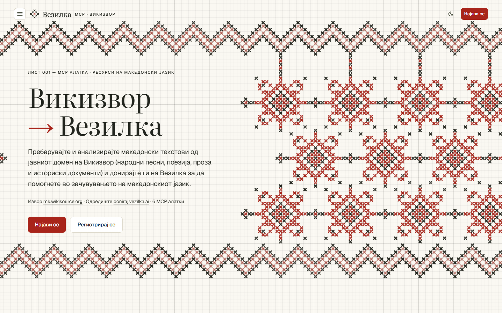
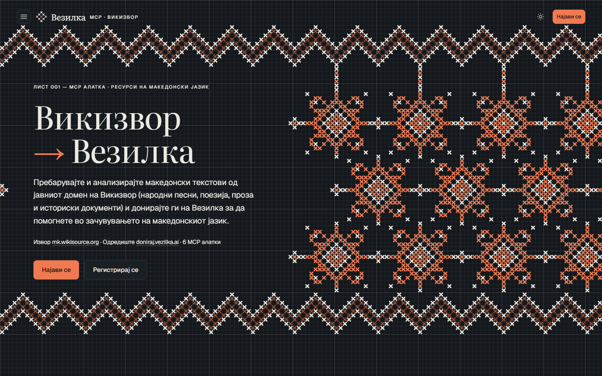
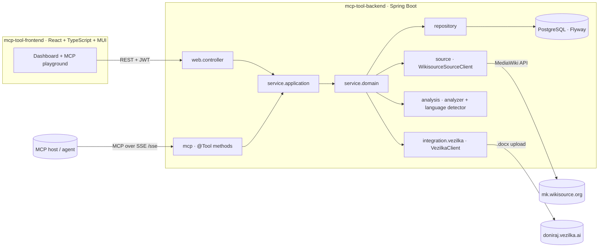

# Vezilka MCP · Викизвор

**An MCP server and dashboard that search, analyze and donate public-domain Macedonian texts
from [Macedonian Wikisource](https://mk.wikisource.org) to [doniraj.vezilka.ai](https://doniraj.vezilka.ai),
the platform that collects Macedonian text to help preserve the language.**

The same functionality is exposed twice: as **Model Context Protocol tools** that an LLM agent
can call over SSE, and as a **fully Macedonian React dashboard** whose design is based on
traditional Macedonian cross-stitch embroidery.



<details>
<summary>Dark theme</summary>



</details>

## Features

- **Search Wikisource** — full-text search over mk.wikisource.org through the MediaWiki Action API.
  Every hit is fetched, cleaned to plain text (verse line breaks kept, navigation and footnotes
  removed) and stored with a **Macedonian-language confidence score**.
- **Analyze texts** — offline, rule-based analysis: keywords with Macedonian stop words removed,
  an extractive summary, and sentence and word counts.
- **Donate to Vezilka** — a draft → approved → submitted workflow. Each text is uploaded to
  doniraj.vezilka.ai as a Word document with a provenance header (title, source URL, licence).
- **MCP server** — six tools over HTTP + SSE, each call recorded in a live tool trace that the
  dashboard shows next to every search.
- **Dashboard** — search runs, a filterable text browser with a reading view, donation batches,
  corpus statistics and an in-app **MCP playground** that lists the tools' JSON Schemas and
  invokes them.
- **Embroidery design system** — an editorial look (Literata + Geist, paper and ink colours,
  hairline rules) on a squared fabric grid. The hero is a canvas that "sews" a generated
  Macedonian folk pattern stitch by stitch (`/` then `\`, like real cross-stitch), with light
  and dark themes.

## MCP tools

| Tool | What it does |
|------|--------------|
| `search_resources` | Search mk.wikisource.org, fetch and score every hit, and store it as a search run |
| `list_search_results` | Compact summaries of a search run's texts, so an agent need not load whole pages |
| `get_resource` | One stored text with its source URL, confidence and analysis |
| `analyze_resource` | Run the analysis (summary, keywords, counts, Macedonian confidence) |
| `donate_resource` | Donate one text to doniraj.vezilka.ai (draft → approve → submit) |
| `corpus_stats` | Totals: search runs, texts, analyzed texts, donation batches, donated texts |

Example agent flow: `search_resources {"query": "Рацин", "limit": 5}` →
`list_search_results {"searchRunId": 1}` → `analyze_resource {"id": 3}` → `donate_resource {"id": 3}`.

## Architecture



The MCP tools and the REST controllers are two entry points over the same layered service code
(`web` → `service.application` → `service.domain` → `repository`), with record DTOs, a
Flyway-owned schema and stateless JWT security.

| Part | Implementation |
|------|----------------|
| Source | `WikisourceSourceClient`: MediaWiki `list=search` + `action=parse`, cleaned with jsoup; polite `User-Agent`, `maxlag` and request delay |
| Language detection | `MacedonianLanguageDetector`: share of Cyrillic and Macedonian-only letters (ѓ ѕ ј љ њ ќ џ) and function-word density; letters not in Macedonian lower the score |
| Analysis | `RuleBasedResourceAnalyzer`: term frequencies without stop words, title-word bonus, top-3 sentence extractive summary |
| Donations | `VezilkaClient` with three modes: `upload` (automatic .docx upload), `export` (ready-to-upload files in `vezilka-outbox/`) and `http` (for a future official API) |

## Tech stack

**Backend:** Java 21 · Spring Boot 3.4 · Spring AI (MCP server, SSE) · Spring Security + JWT ·
Spring Data JPA · PostgreSQL · Flyway · jsoup · Testcontainers · Docker Compose

**Frontend:** React 19 · TypeScript · Vite · MUI · React Router · Axios · HTML canvas

## Getting started

Prerequisites: Java 21, Node 20+, Docker.

```bash
# 1. Database
cd mcp-tool-backend
cp .env.example .env          # then set JWT_SECRET_KEY (openssl rand -base64 48) and SOURCE_USER_AGENT
docker compose up -d

# 2. Backend: http://localhost:8080 (Swagger UI at /swagger-ui/index.html, MCP at /sse)
./mvnw spring-boot:run

# 3. Frontend: http://localhost:3000
cd ../mcp-tool-frontend
npm install
npm run dev
```

Register, log in, and run a search such as **Рацин** or **народни песни**.

### Donations to doniraj.vezilka.ai

Set `VEZILKA_MODE` in `mcp-tool-backend/.env`:

| Mode | Behaviour |
|------|-----------|
| `export` (default) | Writes each donation as a `.docx` (with provenance header) plus a `manifest.jsonl` line to `vezilka-outbox/`, for manual upload at doniraj.vezilka.ai/donate-text |
| `upload` | Uploads each donation automatically to the endpoint the site's own "Донирај текст" form uses. Uploads are anonymous and limited per day by Vezilka; by enabling it you donate under Vezilka's terms of use |
| `http` | Posts JSON to a configurable endpoint with a bearer key, for an official API if Vezilka publishes one |

### Connecting an MCP client

The server speaks MCP over HTTP + SSE at `http://localhost:8080/sse`.

- **MCP Inspector:** `npx @modelcontextprotocol/inspector`, transport **SSE**, URL `http://localhost:8080/sse`.
- **Desktop MCP clients** through the `mcp-remote` bridge:

  ```json
  { "mcpServers": { "vezilka": { "command": "npx", "args": ["-y", "mcp-remote", "http://localhost:8080/sse"] } } }
  ```

- **In-app:** the dashboard's *MCP алатки* page invokes the same tools.

## Tests

```bash
cd mcp-tool-backend
./mvnw test          # Docker must be running: Testcontainers starts a real PostgreSQL
```

The suite covers the language detector, the analyzer, the Wikisource client (canned MediaWiki
responses), the Vezilka upload client (mocked server), repositories and the donation workflow.
The frontend is checked with `npm run lint` and `npm run build`.

## Project structure

```
├── mcp-tool-backend/          Spring Boot · Java 21 · Maven
│   └── src/main/java/mk/ukim/finki/mcptoolbackend/
│       ├── mcp/                 MCP @Tool classes and tool trace
│       ├── source/              Wikisource client
│       ├── analysis/            analyzer and Macedonian language detector
│       ├── integration/vezilka/ doniraj.vezilka.ai clients (upload / export / http)
│       ├── model/  repository/  service/  web/  config/  jobs/
│       └── ...
├── mcp-tool-frontend/         React · TypeScript · Vite · MUI
│   └── src/
│       ├── api/  axios/  contexts/  providers/  hooks/
│       ├── theme/               editorial theme, light and dark
│       └── ui/
│           ├── embroidery/      cross-stitch pattern generator, stitching canvas, fabric grid
│           ├── components/      one folder per component
│           └── pages/
└── docs/screenshots/
```

## Responsible use

Only publicly accessible, public-domain or freely licensed content is collected, Wikimedia's
User-Agent and rate-limit guidance is followed, and every donated text keeps its source URL so
the corpus has clear provenance.

## About

Built by **Ivana Fileva** for the EMC 2026 course at the Faculty of Computer Science and
Engineering (FINKI), UKIM Skopje, on top of the course's MCP tool template.
